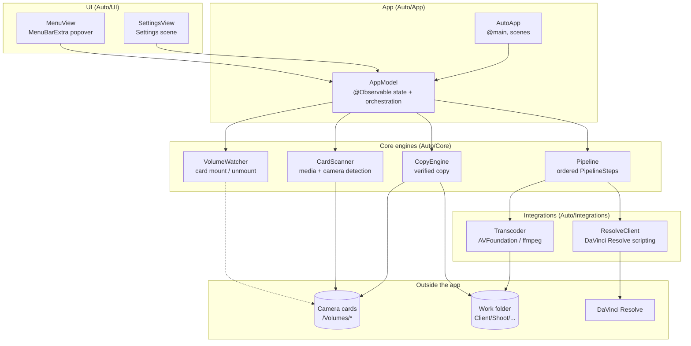
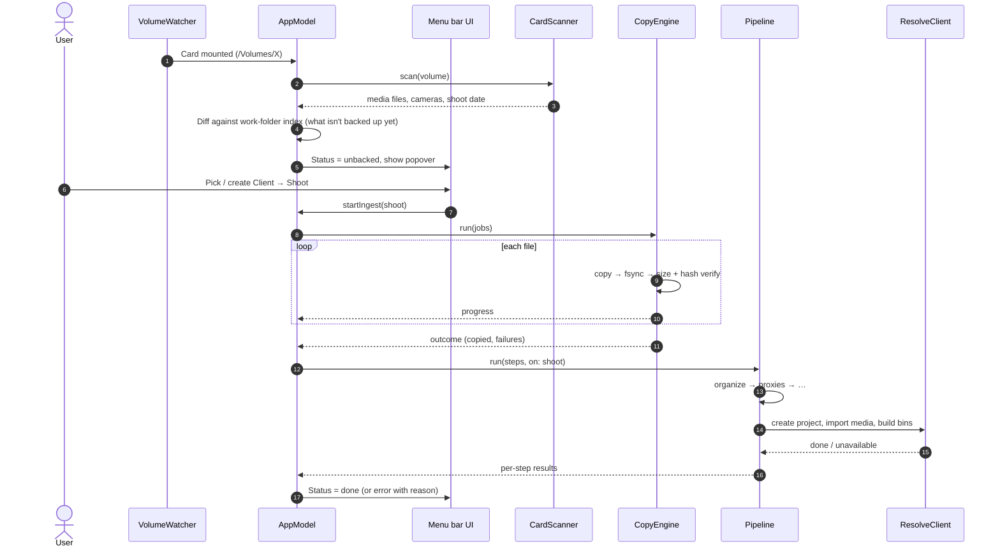

# System Architecture & Technical Design

The architectural blueprint, module boundaries, data flows and design principles for **Auto**.

See also: [CLAUDE.md](CLAUDE.md), [ROADMAP.md](ROADMAP.md).

> **Status:** Boilerplate. Only `App/` and `UI/` exist today. `Core/` and `Integrations/` describe the target design and get built phase by phase (see ROADMAP.md). Keep this file in sync as modules land.

---

## 1. High-Level System Architecture

Auto is a single-process macOS menu bar app (`LSUIElement`, no Dock icon). It cleanly separates the SwiftUI interface, shared app state, pure processing engines, and adapters to external tools.



---

## 2. Directory Layout & Module Responsibilities

```text
Auto/                         # repo root
├── Auto.xcodeproj/           # Xcode project (file-system synchronized groups)
│   └── xcshareddata/xcschemes/Auto.xcscheme   # shared scheme: Auto + AutoTests
├── Auto/                     # App target sources
│   ├── App/                  # Entry point + shared state (thin)
│   │   ├── AutoApp.swift     #   MenuBarExtra + Settings scenes
│   │   └── AppModel.swift    #   @Observable state; orchestrates Core
│   ├── UI/                   # SwiftUI views only, no I/O
│   │   ├── MenuView.swift
│   │   └── SettingsView.swift
│   ├── Core/                 # (planned) pure, testable engines, no SwiftUI
│   ├── Integrations/         # (planned) Resolve / transcoder adapters behind protocols
│   └── Assets.xcassets
├── AutoTests/                # Swift Testing target (hosted in Auto.app)
├── .claude/agents/           # Routed subagents: scout (haiku), architect (opus),
│                             #   implementer (sonnet), reviewer (opus), docs-keeper (haiku)
├── .claude/skills/           # Claude Code skills
│   ├── engine-builder/       #   how to add a Core engine / pipeline step
│   ├── rapid-sprint/         #   scope + pacing against ROADMAP.md
│   └── release-readiness/    #   pre-release verification checklist
├── ARCHITECTURE.md           # this file
├── CLAUDE.md                 # Claude Code instructions
├── ROADMAP.md                # phases, status, backlog, decisions
└── README.md
```

| Layer | May depend on | Must not |
| :--- | :--- | :--- |
| `UI` | `App` (via `@Environment(AppModel.self)`) | Touch files, volumes, processes |
| `App` | `Core`, `Integrations` | Contain copy or pipeline logic itself |
| `Core` | Foundation, CryptoKit, ImageIO, AVFoundation | Import SwiftUI or reference `AppModel` |
| `Integrations` | Foundation, `Process` | Be called directly from views |

---

## 3. Data & Interaction Flow



---

## 4. Technology Stack

| Concern | Choice | Rationale |
| :--- | :--- | :--- |
| UI | SwiftUI `MenuBarExtra` (`.window` style) + `Settings` scene | Native menu bar app with no AppKit status-item boilerplate (Backed used `NSStatusItem` + `NSPopover`). |
| State | `@Observable` `AppModel`, injected with `.environment` | Modern Observation; less boilerplate than Backed's `ObservableObject`/Combine. |
| Concurrency | Swift concurrency; default `MainActor` isolation, heavy work `nonisolated` | Keeps UI correct by default while copying runs off-main. |
| Volume detection | `NSWorkspace` mount notifications / DiskArbitration | Auto-detect cards on insert. |
| Copy verification | Streamed copy + CryptoKit hash (or xxHash later for speed) | Backed's proven approach: verify before marking backed. |
| Metadata | ImageIO (EXIF), AVFoundation (QuickTime), Sony XML sidecars | Camera model / serial detection, carried over from Backed. |
| Proxies | AVFoundation export (ffmpeg optional) | No bundled dependency for the default path. |
| Resolve | DaVinci Resolve scripting API via `Process` (Python) | Same API the `davinci-resolve` MCP uses. Studio for external scripting. |
| Tests | Swift Testing | Parameterized tests, clean `#expect` diagnostics. |
| Persistence | `UserDefaults` for settings; JSON index file in the work folder | Simple, inspectable, no database. |

---

## 5. Resiliency & Failure Defense

1. **Read-only sources:** Auto never writes to, renames or deletes anything on a card.
2. **Verify before trust:** A file counts as backed up only after size and checksum match. Partial copies go to a temp name and are renamed atomically on success.
3. **Never overwrite:** Name collisions at the destination get a unique suffix.
4. **Fixture cards (the "mock mode"):**
   - Tests build a fake card in a temp directory (DCIM / PRIVATE/M4ROOT layouts, tiny media files and sidecars).
   - For manual runs, launch with `-AutoFixtureCard <path>` (UserDefaults launch argument) to treat a folder as a mounted card. *(planned)*
5. **Integration fallbacks:** If Resolve isn't running or scripting is unavailable, the Resolve step reports "skipped: Resolve unavailable" and the ingest still counts as a success. Pipeline steps are independent and re-runnable.
6. **Cancellation:** Copy and pipeline runs are cancellable. Cancelling leaves no half-written files under their final names.

---

## 6. Development & Milestone Protocol

Phases and their checklists live in [ROADMAP.md](ROADMAP.md). In summary:

- **Phase 1: Foundation.** Menu bar shell, settings, work folder, test target. *(done)*
- **Phase 2: Ingest parity with Backed.** Card detection, scanning, verified copy, client/shoot folders.
- **Phase 3: Editing pipeline.** Organize, proxies, Resolve project setup.
- **Phase 4: Polish & release.** Notifications, history, signing/notarization.
