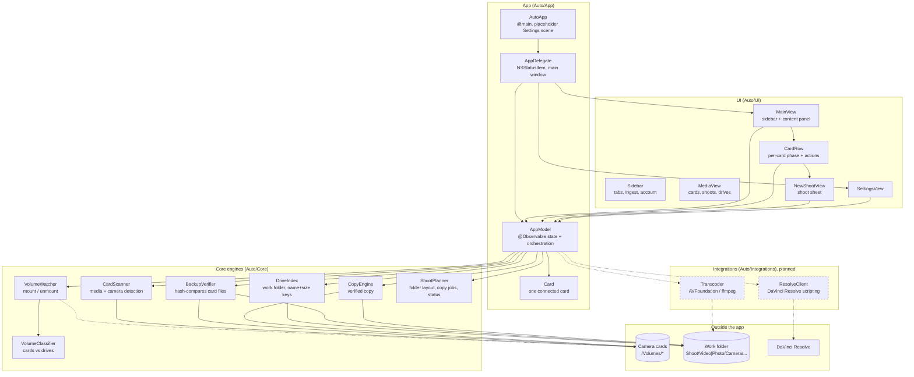
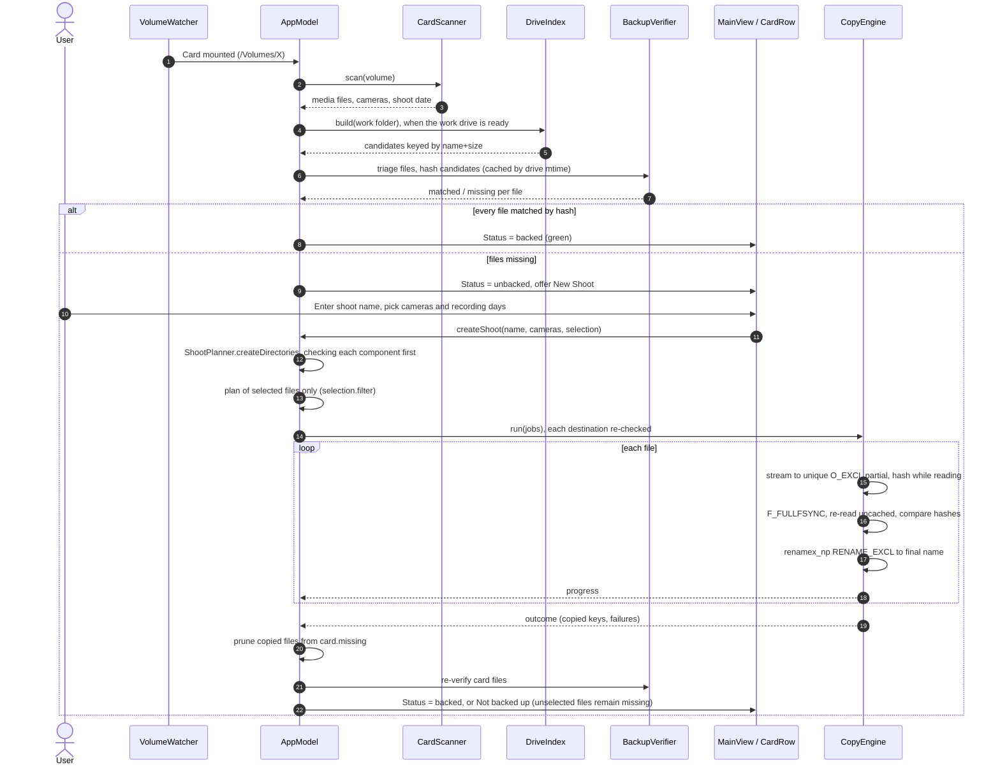

# System Architecture & Technical Design

The architectural blueprint, module boundaries, data flows and design principles for **Auto**.

See also: [CLAUDE.md](CLAUDE.md), [ROADMAP.md](ROADMAP.md).

> **Status:** `App/`, `UI/` and `Core/` exist (Phase 2 ingest parity, in progress). `Integrations/` and the Phase 3 pipeline are still the target design (see ROADMAP.md). Keep this file in sync as modules land.

---

## 1. High-Level System Architecture

Auto is a single-process macOS menu bar app (`LSUIElement`, no Dock icon). It cleanly separates the SwiftUI interface, shared app state, pure processing engines, and adapters to external tools.



---

## 2. Directory Layout & Module Responsibilities

```text
Auto/                         # repo root
├── Auto.xcodeproj/           # Xcode project (file-system synchronized groups)
│   └── xcshareddata/xcschemes/Auto.xcscheme   # shared scheme: Auto + AutoTests
├── Auto/                     # App target sources
│   ├── App/                  # Entry point + shared state (thin)
│   │   ├── AutoApp.swift     #   @main; placeholder Settings scene (Cmd-comma goes to AppDelegate)
│   │   ├── AppDelegate.swift #   NSStatusItem (left click: window, right click: menu); main window (Settings is a tab)
│   │   ├── AppTab.swift      #   sidebar tabs + light/dark AppearanceMode
│   │   ├── AppModel.swift    #   @Observable state; orchestrates Core
│   │   └── Card.swift        #   one connected card: volume, files, cameras, phase, copy plan
│   ├── UI/                   # SwiftUI views only, no I/O
│   │   ├── MainView.swift    #   sidebar + floating content panel, switches on AppModel.selectedTab
│   │   ├── Sidebar.swift     #   logo, tabs, Ingest button, account row (appearance menu)
│   │   ├── MediaView.swift   #   Media tab: stats, cards, recent shoots (placeholder), drives
│   │   ├── EditPlaceholderView.swift # empty Video Edit / Photo Edit tabs
│   │   ├── Theme.swift       #   adaptive color tokens, SurfaceCard, PrimaryPillButtonStyle
│   │   ├── CardRow.swift     #   per-card header, phase content and actions, per-camera day chips; static StatusDot
│   │   ├── DayChip.swift     #   recording-day chip, shared by CardRow and the New Shoot sheet
│   │   ├── NewShootView.swift#   sheet: shoot name, cameras and recording days, live folder preview (Theme tokens)
│   │   └── SettingsView.swift#   Settings tab; "Soon" rows persist values nothing reads yet
│   ├── Core/                 # pure, testable engines, no SwiftUI
│   │   ├── VolumeWatcher.swift     #   NSWorkspace mount notifications, refresh off main
│   │   ├── VolumeClassifier.swift  #   card vs work/backup drive vs ignored volume
│   │   ├── MediaTypes.swift        #   extensions → MediaKind, skipped folders
│   │   ├── MediaFile.swift         #   MediaFile, MediaKind, Camera models
│   │   ├── CardScanner.swift       #   enumerate media, camera detection, shoot date
│   │   ├── DriveIndex.swift        #   work-folder media grouped by name+size
│   │   ├── BackupVerifier.swift    #   checksum-compares card files with drive candidates
│   │   ├── CopyEngine.swift        #   verified copy with cancel
│   │   ├── ShootDays.swift         #   recording days per camera (ShootDays.byCamera)
│   │   ├── ShootSelection.swift    #   (camera, day) include-set for a shoot; unselected files stay on the card
│   │   └── ShootPlanner.swift      #   shoot folder naming, planned folder rows, copy jobs, destination checks (checkDestination/createDirectories), CardPhase, StatusAggregator
│   ├── Integrations/         # (planned, Phase 3) Resolve / transcoder adapters behind protocols
│   └── Assets.xcassets
├── AutoTests/                # Swift Testing target (hosted in Auto.app)
│   ├── Support/FixtureCard.swift   #   builds a fake card in a temp dir
│   └── *Tests.swift          #   one file per Core engine, plus AppModelTests
├── .claude/agents/           # Routed subagents: scout (haiku), architect (opus),
│                             #   implementer (sonnet), reviewer (opus), docs-keeper (haiku)
├── .claude/skills/           # Claude Code skills
│   ├── engine-builder/       #   how to add a Core engine / pipeline step
│   ├── rapid-sprint/         #   scope + pacing against ROADMAP.md
│   └── release-readiness/    #   pre-release verification checklist
├── ARCHITECTURE.md           # this file
├── CLAUDE.md                 # Claude Code instructions
├── ROADMAP.md                # phases, status, backlog, decisions
└── README.md
```

| Layer | May depend on | Must not |
| :--- | :--- | :--- |
| `UI` | `App` (via `@Environment(AppModel.self)`) | Touch files, volumes, processes |
| `App` | `Core`, `Integrations` | Contain copy or pipeline logic itself |
| `Core` | Foundation, CryptoKit, ImageIO, AVFoundation; AppKit/DiskArbitration in `VolumeWatcher` only | Import SwiftUI or reference `AppModel` |
| `Integrations` | Foundation, `Process` | Be called directly from views |

---

## 3. Data & Interaction Flow



The Phase 3 pipeline (organize → proxies → Resolve project) is not built yet and is not in these diagrams.

---

## 4. Technology Stack

| Concern | Choice | Rationale |
| :--- | :--- | :--- |
| UI | SwiftUI windows hosted by an AppKit `AppDelegate` with an `NSStatusItem` | The status item opens a real window instead of a dropdown. `MenuBarExtra` was dropped; SwiftUI's `openSettings` is unreliable from an accessory-app menu, so AppDelegate routes Cmd-comma to the Settings tab of the main window. |
| State | `@Observable` `AppModel`, injected with `.environment` | Modern Observation; less boilerplate than Backed's `ObservableObject`/Combine. |
| Concurrency | Swift concurrency; default `MainActor` isolation, heavy work `nonisolated` | Keeps UI correct by default while copying runs off-main. |
| Volume detection | `NSWorkspace` mount/unmount notifications; `FileManager.mountedVolumeURLs` on refresh, off the main actor | Auto-detect cards on insert; generation guard drops stale refreshes. |
| Copy verification | Streamed CryptoKit hash on write, `F_FULLFSYNC`, uncached read-back (`F_NOCACHE`) hash compare (xxHash later for speed) | Backed's proven approach, hardened: verify what is on disk before marking backed. |
| Metadata | ImageIO (EXIF), AVFoundation (QuickTime), Sony XML sidecars | Camera model / serial detection, carried over from Backed. |
| Proxies | AVFoundation export (ffmpeg optional) | No bundled dependency for the default path. |
| Resolve | DaVinci Resolve scripting API via `Process` (Python) | Same API the `davinci-resolve` MCP uses. Studio for external scripting. |
| Tests | Swift Testing | Parameterized tests, clean `#expect` diagnostics. |
| Persistence | `UserDefaults` for settings (work folder, auto-open, appearance); the drive index is rebuilt by scanning the work folder | Simple, no database. A persisted, resumable index is Phase 4. |

---

## 5. Resiliency & Failure Defense

1. **Read-only sources:** Auto never writes to, renames or deletes anything on a card.
2. **Verify before trust:** A card is backed up only when every file has a checksum-identical copy on the work drive (`BackupVerifier`). Name and size only pick candidates. Copies stream into a unique `O_EXCL` partial, are flushed with `F_FULLFSYNC`, re-read uncached, and are hashed again before they count.
3. **Never overwrite:** The final name is claimed with `renamex_np(RENAME_EXCL)`, so an existing file is never replaced. A name collision gets a unique suffix instead. An identical file from an earlier run is kept.
4. **Fixture cards (the "mock mode"):**
   - Tests build a fake card in a temp directory (DCIM / PRIVATE/M4ROOT layouts, tiny media files and sidecars) via `AutoTests/Support/FixtureCard.swift`.
   - For manual runs, launch with `-AutoFixtureCard <path>` (UserDefaults launch argument) to treat a folder as a mounted card. The window also opens at launch, since no mount event fires for it.
5. **Integration fallbacks:** *(Phase 3, planned)* If Resolve isn't running or scripting is unavailable, the Resolve step reports "skipped: Resolve unavailable" and the ingest still counts as a success. Pipeline steps are independent and re-runnable.
6. **Cancellation:** Copy and verification runs are cancellable. A failed or cancelled copy removes its partial file, so nothing half-written is left under a final name.
7. **Destination checks:** Before any folder is created and again before each copy, the destination must resolve (symlinks resolved through the nearest existing ancestor) to inside the work folder, must not be on a card, and must not have a file where a folder should be (`ShootPlanner.checkDestination` / `createDirectories`). Path containment is lexical. Dangling symlinks are rejected, and the work folder itself is never created: if it is missing (drive unplugged), New Shoot and Copy stop with an error.

---

## 6. Development & Milestone Protocol

Phases and their checklists live in [ROADMAP.md](ROADMAP.md). In summary:

- **Phase 1: Foundation.** Menu bar shell, settings, work folder, test target. *(done)*
- **Phase 2: Ingest parity with Backed.** Card detection, scanning, verified copy, shoot folders. *(engines and app wiring landed; manual end-to-end test pending)*
- **Phase 3: Editing pipeline.** Organize, proxies, Resolve project setup.
- **Phase 4: Polish & release.** Notifications, history, signing/notarization.
